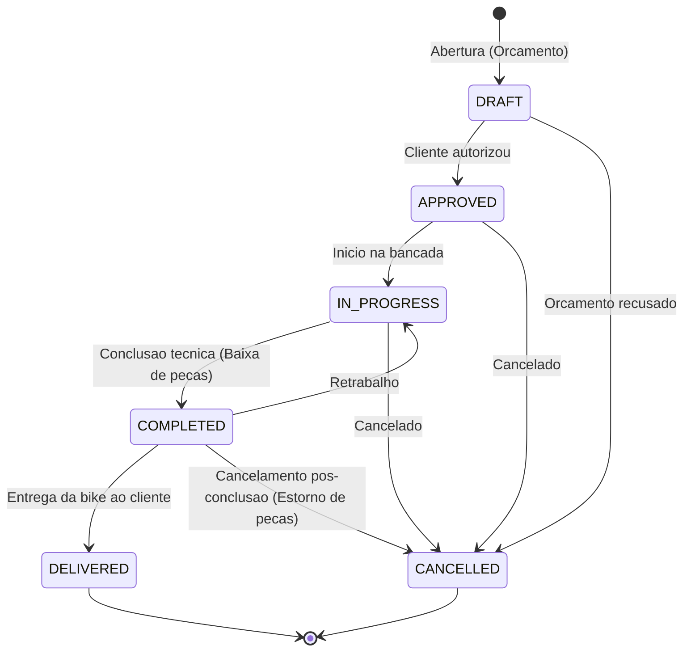
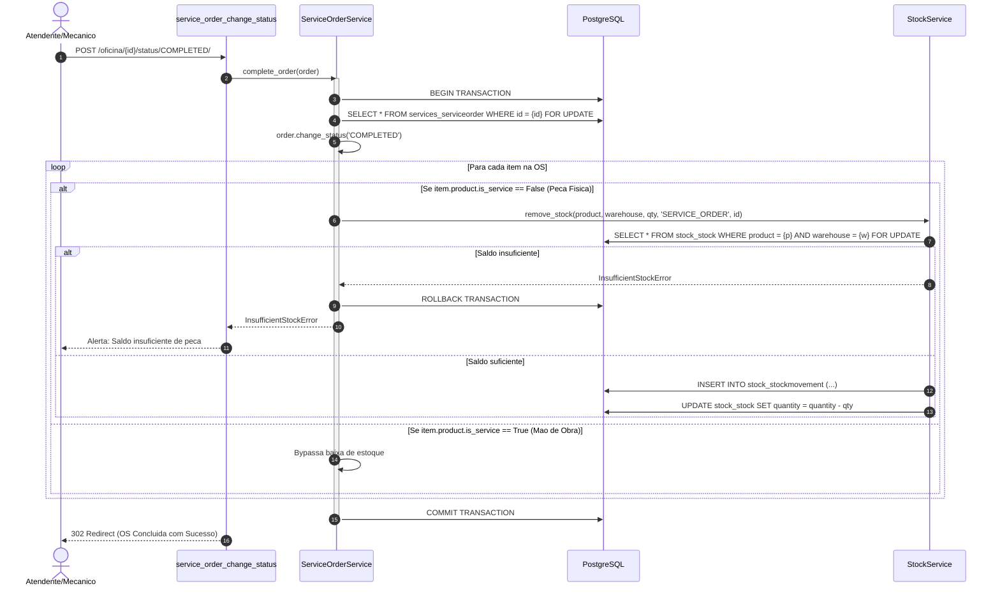

# Arquitetura e Engenharia de Software - Bike Shop ERP

Este documento detalha as decisoes arquiteturais, padroes de projeto, fluxo de dados e mecanismos de integridade do Bike Shop ERP.

---

## 1. Visao Geral do Sistema

O Bike Shop ERP adota o modelo monolitico modular em Django, priorizando coesao de dominio e simplicidade operacional. A camada visual baseia-se em Server-Side Rendering (SSR) potencializado por HTMX para interatividade sem overhead de SPAs.

### 1.1 Mapa de Modulos (Apps Django)

```
bike-shop-erp/
├── core/         # Configuracoes globais, modelos base, dashboard e tratamento de excecoes
├── catalog/      # Gestao de produtos, pecas, marcas e categorias
├── customers/    # Cadastro e historico de clientes
├── stock/        # Controle de depositos, saldo de estoque e rastreabilidade (StockMovement)
├── sales/        # Ponto de Venda (PDV), fluxo de carrinho e faturamento rapido
└── services/     # Gestao de Oficina Mecanica, Ordens de Servico e Checklist
```

### 1.2 Principios de Integracao entre Modulos

1. **Isolamento de Dominio:** Modulos nao realizam mutacoes diretas em tabelas de outros modulos via ORM puro; mutacoes cruzadas sao intermediadas por Services dedicados (ex: `StockService`).
2. **Camada de Servico (Service Layer):** Regras de negocio, calculos e transicoes de estado vivem em `services/`, mantendo `views.py` como adaptadores de entrada HTTP enxutos (4 a 20 linhas).
3. **Persistencia Atomica:** Toda operacao que envolve multiplos registros ou impacto em estoque e encapsulada sob decorador `@transaction.atomic`.
4. **Zero Emojis:** Todo codigo, interface, documentacao e logs estruturados utilizam texto puro ou icones vetoriais SVG.

---

## 2. Modulo de Oficina Mecanica (Services)

O app `services` gerencia o ciclo operacional de manutencao, reparos e revisoes de bicicletas.

### 2.1 Maquina de Estados da Ordem de Servico

A `ServiceOrder` possui um ciclo de vida estrito regido por uma maquina de estados finita:



#### Transicoes Validas e Regras de Negocio

| Origem          | Destino         | Acao e Efeito Colateral                                                  |
| --------------- | --------------- | ------------------------------------------------------------------------ |
| `DRAFT`       | `APPROVED`    | Valida orcamento; libera para agendamento e execucao.                    |
| `DRAFT`       | `CANCELLED`   | Arquiva orcamento recusado.                                              |
| `APPROVED`    | `IN_PROGRESS` | Atribui a bancada do mecanico; inicia contagem de horas.                 |
| `APPROVED`    | `CANCELLED`   | Cancela ordem aprovada antes de iniciar execucao.                        |
| `IN_PROGRESS` | `COMPLETED`   | Baixa automatica de estoque de pecas fisicas no deposito vinculado a OS. |
| `IN_PROGRESS` | `CANCELLED`   | Cancela atendimento em andamento.                                        |
| `COMPLETED`   | `DELIVERED`   | Registra entrega finalizada e pagamento/saida do veiculo.                |
| `COMPLETED`   | `CANCELLED`   | Executa estorno automatico das pecas fisicas para o deposito.            |
| `COMPLETED`   | `IN_PROGRESS` | Retorno para bancada em caso de revisao ou retrabalho.                   |

---

## 3. Integridade Transacional e Concorrencia

Para garantir consistencia sob multiplas requisicoes concorrentes (ex: mecanico e atendente interagindo simultaneamente), o sistema implementa bloqueio pessimista e rollback total.

### 3.1 Bloqueio Pessimista (`select_for_update`)

Em qualquer transicao de status (`approve_order`, `complete_order`, `cancel_order`) ou manipulacao de itens (`add_item`, `remove_item`):

1. O registro `ServiceOrder` e bloqueado no banco de dados com `select_for_update()`.
2. Requisicoes simultaneas sao enfileiradas ate o termino da transacao corrente.
3. Se o status for alterado pela primeira transacao, a segunda transacao revalida a maquina de estados e rejeita a operacao com `InvalidStatusTransitionError`.
4. As baixas de saldo na tabela `Stock` tambem executam `select_for_update()` para evitar saldo negativo.

### 3.2 Diagrama de Sequencia: Conclusao de OS com Baixa de Estoque



---

## 4. Separacao entre Pecas Fisicas e Mao de Obra

O modelo unificado de produtos do Bike Shop ERP distingue produtos fisicos de servicos atraves da flag booleana `is_service`:

- **Pecas Fisicas (`is_service=False`):**
  - Exigem controle quantitativo de estoque por deposito (`Warehouse`).
  - Quando aplicadas na OS, geram movimentacao `StockMovement` com `reference_type=SERVICE_ORDER`.
  - Falha na conclusao da OS se saldo for inferior a quantidade requerida.
- **Mao de Obra / Servicos (`is_service=True`):**
  - Nao controlam inventario fisico.
  - Calculam valor de mao de obra e somam no campo `services_amount` da OS.
  - Permitem faturamento e orcamento sem validar saldo de estoque.

---

## 5. Rastreabilidade e Auditoria

Todas as mutacoes em estoque decorrentes da oficina mantem auditoria reversa:

- `StockMovement.reference_type = 'SERVICE_ORDER'`
- `StockMovement.reference_id = ServiceOrder.id`
- `StockMovement.reason = 'Baixa de peca na OS {id}'` ou `'Estorno por cancelamento da OS {id}'`

Isso permite auditar exatamente quais pecas foram utilizadas em cada bicicleta atendida na oficina ao longo do tempo.
